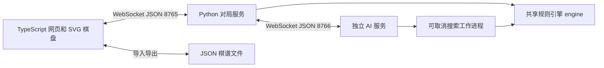

# 中国象棋系统设计说明

当前模块责任：组长负责界面交互、对局管理与系统测试；组员负责总体设计、象棋规则与 AI 核心，详细边界见 [分工说明](分工说明.md)。

## 总体方案

系统把显示、权威规则与 AI 计算分开。浏览器不自行推导走法，而是显示对局服务返回的合法走法；AI 也导入同一规则包。搜索与网络事件循环运行在不同进程，从而允许搜索期间处理暂停与取消。



界面用朱红区分红方、深墨区分黑方、绿色区分合法目标与推荐。所有棋盘文字与控制均为原生文本或 SVG，能够清晰缩放；窄屏按棋盘、操作栏顺序排列。

## 规则与局面

棋盘采用长度 90 的一维数组，索引为行乘 9 加列。红方编码为正，黑方为负；棋子类型 1—7 对应将帅、士、象、马、车、炮、兵卒。初始局面由函数生成，红先黑后。

`pseudo_targets` 处理棋子几何与障碍，`attacked` 独立检测攻击关系，`legal_moves` 在临时棋盘走一步后检查己方将帅安全。攻击检测不递归调用合法走法，避免循环判定。引擎禁止生成吃将帅的普通走法，以无合法走法判断将死或困毙。

`Position` 是不可变对象，包含棋盘、行棋方、连续无吃子半回合数以及规范局面键历史。落子返回新对象，悔棋保留对应历史前缀，不会残留已撤销分支的重复局面次数。裁决先检查将死/困毙，再检查三次重复，最后检查 120 半回合无吃子。

此规则集是课程版，未实现完整竞赛长将长捉裁决。

## 对局状态

`Game` 管理不可变局面序列、走法序列、模式、执方、回放位置与控制状态。`Controller` 管理当前对局与本次运行终局结果映射。

- `gameId` 隔离新旧对局；`revision` 隔离同局的新旧状态。悔棋不会回退版本号。
- `active/finished` 是实际局面状态，`running/paused/replay` 是控制状态；回放显示局面与实际终局分开返回。
- 网络命令先检查版本，再修改状态；重复请求 ID 不会重复落子。
- 进入新局、悔棋、暂停或回放后取消旧 AI 任务。即使旧结果已经到达，身份与版本检查仍会阻止应用。
- 统计使用 `gameId → 当前有效结果` 映射。终局悔棋撤回该局结果，重放与导入不增加统计。

## 两套通信接口

完整字段定义见根目录 SPEC 第 6 节；实际实现分别在 `backend/server.py` 和 `ai/server.py`。

网页命令统一含 `protocolVersion/type/requestId/action/gameId/revision/payload`。变更命令先确认，再推送完整状态；前端只依据状态刷新棋盘。错误含 `code/message`，非法消息不会改变棋盘。`STALE_STATE` 同时返回最新状态。

AI 搜索请求含当前局面、行棋方、无吃子计数、重复局面历史、搜索深度与时间上限。返回着法、已完成深度、节点数、耗时、分数和主变。工作进程可以被取消；自动行棋失败、超时、断连或非法走法使对局暂停并显示错误。回放中的推荐失败保留原回放状态和节点。

外部客户端演示：启动 AI 服务后，在根目录运行 `.venv/Scripts/python.exe -m scripts.ai_client`，该客户端从标准初始局面构造完整合法请求，无需网页或对局服务。

参考 API 文档：WebSocket 异步服务使用 [websockets 15.0 文档](https://websockets.readthedocs.io/en/15.0/reference/asyncio/server.html)，前端构建采用 [Vite 文档](https://vite.dev/guide/)。

## AI 算法

```text
best ← 确定性合法保底走法
for depth = 1..maxDepth:
    value, pv ← Negamax(position, depth, -∞, +∞)
    若时间耗尽：保留上一完整迭代并退出
    best ← pv 首步
    若已证明短程获胜：退出
return best, completedDepth, nodes, elapsed, value, pv

Negamax(position, depth, alpha, beta):
    检查时间预算并生成合法走法
    若终局：返回带距离的胜负分或和棋 0 分
    若 depth=0：进入静态搜索，继续吃子并完整应将
    查询包含重复历史和无吃子计数的置换表
    按缓存最佳步、吃子、杀手与历史启发顺序遍历
    首个分支使用完整窗口，其余先用 PVS 窄窗口，需要时重新完整搜索
    更新最佳步与 alpha；alpha >= beta 时剪枝
```

兵基础价值为 100，车 900、马 420、炮 450、士象各 200；将帅不参与可吃子价值累加。位置项按红黑镜像计算，包括兵推进与过河、马靠中与发展、车炮位置；将帅安全包含离中列惩罚、士象护卫和受将军惩罚。权重集中于 `engine/evaluation.py`，方便答辩修改。

将死与困毙均为负大分，按搜索距离修正，优先尽快获胜、尽量推迟失败。无完整第一层时只返回预先验证的合法保底步，不把异常伪装成正常搜索。

升级版加入静态搜索，正常叶节点延伸最多 8 层吃子；被将军时不能停着估值，须完整应将。达到总计 64 层安全边界时放弃当前迭代并保留之前完成结果。该上限与时间预算共同限制极端分支。

请求内置换表保存精确值或上下界，分数键包含棋盘、行棋方、无吃子计数及全部历史局面键的出现次数，避免和棋历史混用；将死分按距离归一化。另有棋盘级最佳步排序缓存、合法走法及静态评估缓存、杀手着法和历史排序。所有缓存仅属于一次请求，主要缓存限制为 30000 项。PVS 使用窄窗口试探后，在可能改善结果时完整重搜。

当前自研 v4 预计算棋盘几何并复用完整合法走法，增加完整重搜的 aspiration window；评估增加机动性、阶段马炮价值、王区压力及底线兵衰减。自研标准/强力为 8/1500、12/10000，基础 2/500，旧棋谱保留原参数。具体权重与实验见第二轮棋力升级说明。

独立 AI 服务另提供 Pikafish 模式，由 `backend/pikafish.py` 重建完整历史并转换 FEN/UCI，限制根候选并重新验证最佳步与主变，直接拥有和回收原生进程。皮卡鱼预设深度上限 128，时间预算与各档相同；初始化开销另记。AIConfig 可选 engine，含皮卡鱼的记录使用 v2；纯自研保留 v1。第三方算法及 NNUE 权重不属于自研成果，来源和许可见 third_party/pikafish。

当前没有开局库、残局库或训练模型；静态搜索只缓解地平线效应，不能消除所有漏算。棋力结论只针对已执行实验，不能外推至教师实战。升级结果与原版结果分别保存，见 `棋力升级说明.md`。

## 对局记录

JSON 记录包含固定格式名、版本、规则集、带时区时间、对战配置、从初始局面开始的着法数组及结果。导入时从标准初始局面逐步验证，结果必须一致；不信任外部快照，也不执行文件内容。校验失败保留原局。

回放取已保存的不可变局面，逐步展示并保留实际对局；从历史节点继续截断未来步骤。导入历史继续会创建新对局 ID，导入的既往结果不贡献统计。

## 验证证据

规则、状态、搜索与真实 WebSocket 测试见 `tests`；固定战术局面见 `fixtures`；自对弈结果及环境元数据见 `docs/experiments`。最新执行结果与局限统一记在 `docs/acceptance.md`，报告不得使用未经核实的指标。
